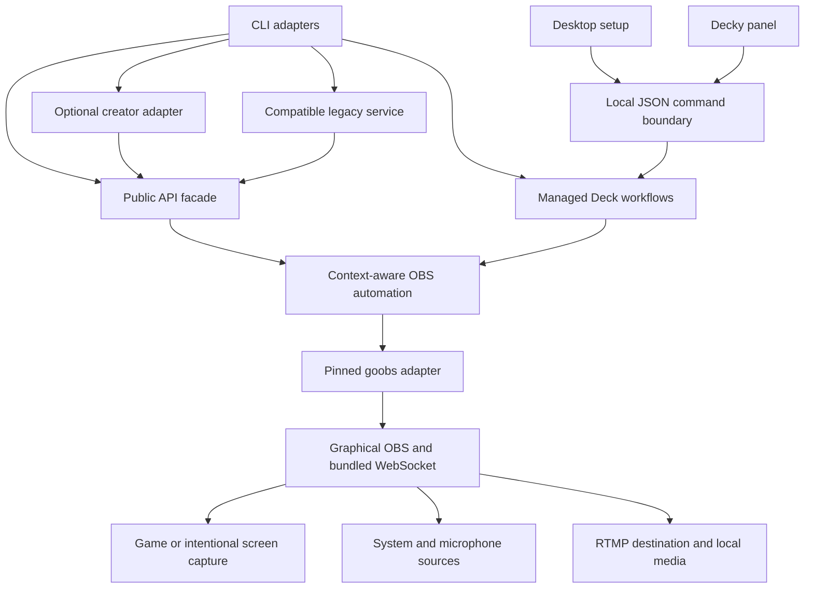

# Architecture

deckystream is a local OBS controller with a Steam Deck integration. The working
display name comes from `product.json`; compatible executable, Go module, plugin
identity and storage namespace remain `obsgod`/`OBSGod`. A display-name change
does not migrate an installation or establish new repository ownership.

This is the canonical component and boundary description. See
[vocabulary](ONTOLOGY.md), [decisions](DECISIONS.md), [roadmap](ROADMAP.md),
[security](SECURITY.md) and [continuity](CONTINUITY.md). Feature guides describe
individual workflows; qualification records identify the exact tested revision.

The selected aurora profile keeps original raster concepts, a separately authored
vector source and one recorded generated hero master distinct. Pinned local
exports feed ordinary PNG downloads, the offline gallery, README/site and the
bundled compact UI mark. `product.json` supplies lowercase display styling;
compatibility IDs and empty Identity approval/token layers remain unchanged.
The decorative gradient is separate from observed streaming status. Rendering
and provenance checks do not imply rights, publisher or actual device approval.

The retained cleanup tool creates a verified durable private export before an
explicit wipe. The export lives in an owned XDG data sibling outside selected
removal roots and intentionally survives; it can contain credentials and is not
public evidence. Existing cleanup leases/path identities gate export and removal.
No automatic restore or new provider/OBS credential store is introduced. Normal
Decky removal and optional legacy retirement remain separate scopes.

## Components and dependency direction

| Component | Responsibility and boundary |
| --- | --- |
| `main.go`, `internal/commands` | CLI composition, flags/help and command adapters |
| `internal/config` | Generic connection configuration and named connection profiles; separate from managed Deck settings and OBS's native profiles |
| `internal/obs` | Compatible legacy CLI adapter over `pkg/api/v1.Client.Legacy`; lazy cached facade, command context and unchanged acknowledgement/output behavior |
| `pkg/api/v1` | Versioned facade with independent public models/errors, bounded serialized operations and invocation approvals; confirmed-state operations plus a closed typed legacy compatibility surface |
| `pkg/automation` | Context-aware OBS control/observation/workflows and legacy request implementations through pinned `goobs`; no application installation, provider API or UI |
| `internal/obstransport` | Private legacy dialer/User-Agent construction seam; no raw transport option in the public API |
| `pkg/creator/v1` | Optional creator adapter consuming the public facade, with environment-backed RTMP providers; used by `obsgod creator` |
| `internal/deck` | Managed Linux/Flatpak OBS lifecycle, serialized controls, private settings, capture, audio and local media; owns only its managed instance/data |
| `steamdeck/bridge.py`, `steamdeck/decky/main.py` | Unprivileged JSON invocation of `obsgod deck`; no duplicate OBS WebSocket implementation |
| `steamdeck/decky/storage.py` | Decky-owned map/receipt/job/log boundaries around the retained canonical XDG credentials and managed state/control lock |
| `steamdeck/decky/dependency_setup.py` | Consented, asynchronous per-user Flatpak setup; bounded jobs and re-observation, never OBS launch or broadcasting |
| `steamdeck/setup.*`, `steamdeck/decky/src` | Desktop setup and controller panel; project observed state rather than infer success from a click |
| `steamdeck/install.py`, `update.py`, `uninstall.py` | Validated install/replacement/recovery/removal; preserve ordinary OBS, unrelated plugins and shared dependencies |
| `steamdeck/capture` | Narrow app-filtered Gamescope/PipeWire source; unusable game selection cannot become desktop capture |
| `scripts`, `.github/workflows`, `docs/evidence` | Builds, local/CI checks, packaging and evidence; compilation is not execution on the target |

The [native destination form](docs/native-configuration.md) reads a named,
credential-free configuration view through the same local JSON boundary. Sparse
edits merge under Go's existing shared control lock and use its existing settings/
secret writer; they do not introduce another credential store. Saving requires
positively closed managed OBS and known idle outputs. Closing idle OBS is a
separate confirmed action. Configuration, password changes and connection tests
never start a broadcast. The adapter expires/coalesces observations, serializes
actions with setup/control work and clears private payloads after use.

The [settings boundary](docs/settings-boundary.md) requires complete schema-v1
readback and consistent action gates before client readiness. Go-produced shared
wire fixtures preserve first-run, missing-key, running and legacy-dimension
states across Go/Python/JS. Capture-mode edits have a short complete-operation
budget including lock wait, child cleanup and fresh readback; timed-out UI
promises do not imply cancellation. The backend retains operation identity
until its owned command has exited. Missing output knowledge cannot become an
idle default or a green status indicator; Stop/recovery remains available.

`pkg/api/v1` provides independent types/errors and schema-versioned JSON through
`obsgod api`. Operations are serialized, bounded by context/timeouts and close
the acquired transport on cancellation, SDK response timeout or correlation loss
before reuse. Explicit per-operation
approvals preserve output-change authorization. The facade covers snapshots,
streaming, recording/replay, scene/virtual-camera and workflow operations; it is
a candidate contract, not a published stable product release.

All 39 legacy request operations now follow `internal/obs -> pkg/api/v1.Client.Legacy
-> pkg/automation -> pinned goobs`. The compatibility adapter retains command
names, configuration, output formatting, exact status timecodes and request-ACK
mutation semantics. The facade's typed `LegacyRequest`/`LegacyResult` allowlist
cannot accept arbitrary OBS requests or raw JSON; it is a Go compatibility
surface, not a new `obsgod api` JSON command. Each legacy mutating invocation maps
only its explicit action to the matching approval. Normal public v1 methods keep
their stronger observation/readback contracts and existing approval requirements.

The legacy service acquires one cached facade lazily after configuration resolves,
retains its private injected dialer/User-Agent and passes the command context
through every request. Waiting cancellation cannot close another acquired
operation's connection. Acquired cancellation invalidates that connection before
reuse; later independent work may reconnect rather than retry the interrupted
mutation. Owned physical socket close is attempted promptly and once. SDK
Disconnect cleanup completes in the background; `Close` is not a join of every
transport goroutine or proof of OBS output state. A shutdown failure stays an
explicit safe error. See [the migration contract](docs/legacy-api-migration.md)
for request/output compatibility and remaining acceptance. Source integration
and focused regression coverage do not close the full original #9 criteria.

`pkg/creator/v1` consumes the facade without duplicating OBS protocol. Its
plan/start/status/stop/extensions CLI operates on an existing OBS connection;
it neither launches/exits OBS nor creates a companion repository. Its providers
resolve private environment references and configure RTMP(S), without platform
API contacts or provider-reception claims. The owner has deferred the separate
companion and provider OAuth work; their original criteria remain in the future
backlog rather than being marked implemented. The creator/StreamGod boundary in
#13 remains orchestration above OBS control; see
[the boundary decision](docs/decisions/0003-core-and-creator-boundary.md).

## Runtime and state ownership

The primary package is a standard Decky ZIP built by
[`scripts/package-decky.py`](scripts/package-decky.py). Its private staging
contains the complete backend, native helpers, panel and optional loopback
browser setup; a separately installed Desktop application is not required for
those files. [Packaging](docs/decky-package.md) records the pinned source build
and separately scoped official-CLI assembly check. The legacy runtime archive
remains a compatibility path, not an additional normal-plugin requirement.

The [storage bridge](docs/decky-storage.md) uses Decky's supplied metadata/job/log
directories while retaining one canonical XDG settings/secrets/state and control
lease for existing CLI/Desktop users. It does not copy keys or relocate OBS or
recordings. The private map validates the derived paths instead of overriding
them. Preserve the player XDG data/cache roots for the existing Flatpak install.

First-run [dependency setup](docs/dependency-setup.md) is separate from Decky's
plugin installation. No download occurs in lifecycle initialization. Explicit
consent reserves a bounded backend-owned job; decline preserves the plugin and
cancel/reload re-observes actual installed refs. Its shared control lease and
fresh output preflight prevent a legacy Start racing the dependency transaction.

Retained Desktop dependency recovery consumes that same policy from its verified
candidate ZIP and shares the native setup/control leases. The
[cleanup/recovery contract](docs/cleanup-recovery.md) separates loaded-plugin
update identity from optional Desktop inventory, pins deliberate replacement
versions and preserves stable coordination inodes through cleanup. Normal
Decky-managed replacement/removal remains primary; legacy app retirement is an
explicit scope that preserves the active plugin and shared stores.
Dependency installed, OBS launched, authenticated connection and streaming remain
separate observed facts. Native destination/key configuration has its own
readiness contract; selected branding remains separate roadmap work. Dependency
readiness alone does not establish either.

OBS is a graphical application controlled through its bundled WebSocket, not a
headless renderer. Managed operation uses user-installed OBS 28+ and its
compatible GStreamer extension. It does not install a second WebSocket plugin
or disable SteamOS read-only protection. Generic commands connect to an existing
OBS; managed Deck commands use isolated Flatpak configuration and a separately
authenticated local listener. The [isolation repair](docs/flatpak-config-isolation.md)
explains why the environment is selected inside the sandbox.

Go owns serialization, time budgets, source selection and output transitions.
Desktop and Decky use the same control boundary; a cross-process lease prevents
competing managed lifecycle operations. Clients preserve pending/unknown state
when operations are running or observations fail. Desired settings, a successful
request and confirmed OBS output are distinct facts.

The [runtime correctness contract](docs/runtime-correctness.md) specifies fresh
capture ownership under that shared lease, canonical recording observations,
effective microphone policy and bounded Decky teardown. Guarded CLI children
require registered execution permission and Linux parent-death supervision;
packaged Decky helpers use system Python rather than the frozen PluginLoader.
Hooks remain best effort and cannot veto replacement/removal or prove stopped
output when OBS observations are unavailable.

Start observes valid capture and fresh advancing output bytes before reporting
success. A socket, active flag alone or old byte counter cannot establish
readiness. Stop/Cancel use observed state; repeated actions must not manufacture
repeated success notifications. OBS-confirmed transmission still does not prove
a provider received audible video: that needs a separate viewer test.

## Output, privacy and recovery invariants

- Broadcasting requires explicit Start. Installation, recording, replay,
  configuration, reconnection and recovery cannot start a broadcast.
- Game-only selects a verified application's frames. Missing, ambiguous or
  unsupported capture shows intentional idle output; it never silently becomes
  whole-screen capture. Screen capture is a separate choice. Game-only video
  does not imply per-app audio.
- Managed operation preserves ordinary OBS profiles and unknown processes.
  Restart, connection changes, replacement and removal consult stream/recording/
  replay state; unknown state cannot authorize a destructive step.
- Failure cleanup stops only output newly started by that operation. A failed
  repeated Start must not stop a pre-existing stream.
- Audio recovery restores verified sources within bounded retries, preserves
  user mute/gain and leaves system volume alone. Hardware-specific microphone
  availability comes from observations, not just a device-model assumption.
- Recording/replay/streaming have independent lifecycles. Finalize recording and
  observe newly saved replay files before reporting success. Disk pressure
  protects local media without silently ending a stream.
- Idle media are validated local files, privately copied and hashed. Imported
  video is muted. A user rights acknowledgement does not establish ownership or
  permission to redistribute an asset.
- Retention/removal uses an explicit validated preview. Changed, unindexed,
  interrupted or symlinked files are not broad deletion targets. Media removal
  is a separate choice from application uninstall.

See [resilience](docs/runtime-resilience.md),
[recording/replay](docs/recording-replay.md) and
[device acceptance](docs/m3-device-acceptance.md) for procedures and limitations.

## Configuration, secrets and paths

Generic settings resolve flags, environment, selected JSON profile, base JSON
and defaults in that order. Ordinary OBS defaults to localhost:4455; the managed
listener uses its separate local endpoint. Generic `--password` remains a legacy
interface; prefer password-file or environment/reference support so secrets need
not enter argv/history. See [configuration](docs/configuration.md) for exact
names, profiles and paths.

Managed settings/data/state/cache/ephemeral coordination use their respective
XDG roles. Decky-provided user/path values locate the actual player and
integration directories. Loader persistent runtime-data is not interchangeable
with `XDG_RUNTIME_DIR`. Setup is loopback-only with token/origin checks. Clients
invoke a fixed executable with JSON input rather than building shell commands
containing stream keys.

Destination keys, OBS control passwords and setup authorization tokens have
different purposes and must not be reused. Diagnostics/support bundles project
allowlisted safe fields rather than unrestricted errors/configuration. Never
add arbitrary server logs or credentials to public evidence. See
[security policy](SECURITY.md).

## Product and external boundaries

The generic core owns OBS control. Provider presets validate RTMP(S) destination
configuration above it; presets do not imply OAuth, account APIs or simultaneous
multistream. Creator automation/content distribution are optional consumers.
Local recording/replay does not grant content rights or authorize publication.

The owner selected **Decky Stream** as a working name and requested a future
`decky-stream` identity. Organization, final mark/creative approval, domain,
transfer and publication remain owner decisions. Separate companion/OAuth work
is explicitly deferred. Configured funding links do not establish verified payout
ownership. Unconfigured wallets
remain hidden. #51 separately holds monetization and Store research; completing
the local plugin does not resolve that research.

## Change, release and evidence boundaries

Source preparation, local checks and reviewable draft PRs are authorized for this
completion campaign. Publication, deployment, spending, transfers and changes in
other repositories need their applicable owner authorization. This adds no gate
for routine reversible implementation. Respect protections and inspect workflow
side effects before a merge that could publish or deploy.

API/toolchain versions, package candidates, published releases and installed
runtimes are distinct identities. Record exact source/dirty state, commands,
platform/tools/dependencies, hashes and outcomes. Distinguish passed, failed,
skipped, unavailable and unrun. Old receipts become historical after source
changes. Native OBS, fixtures, browsers and cross-builds cannot establish actual
SteamOS/Flatpak/Gamescope/controller/provider/adoption or hosted CI acceptance.
Packaging a candidate does not publish it.

The owner requested consolidation after review/merges into one implementation
checklist, keeping #51 separate. A superseded issue must transfer every remaining
original criterion and dependency. Consolidation cannot mark missing device,
CI, rights, review or adoption evidence passed.

## Maintainer build qualification

The maintained candidate executes and inspects both complete primary plugin
builds as the checkout owner, compares canonical bytes and uses the primary ZIP
in packaged checks. Compatibility archives remain independently checked; they
are not a required application for normal installation. The optional official
CLI check remains prepared-payload assembly rather than source-compilation proof.

[Local CI](docs/local-ci.md) provides an opt-in constrained profile with measured
host/daemon capacity, fresh per-attempt paths and a serial matrix evidence session.
An early resource refusal is unavailable/unrun workflow evidence. Explicit
post-consumer cleanup is limited to private compiler caches; source, modules,
toolchains, artifacts, receipts and package/network presets are retained. These
maintainer checks do not replace actual Deck/provider/hosted acceptance.
