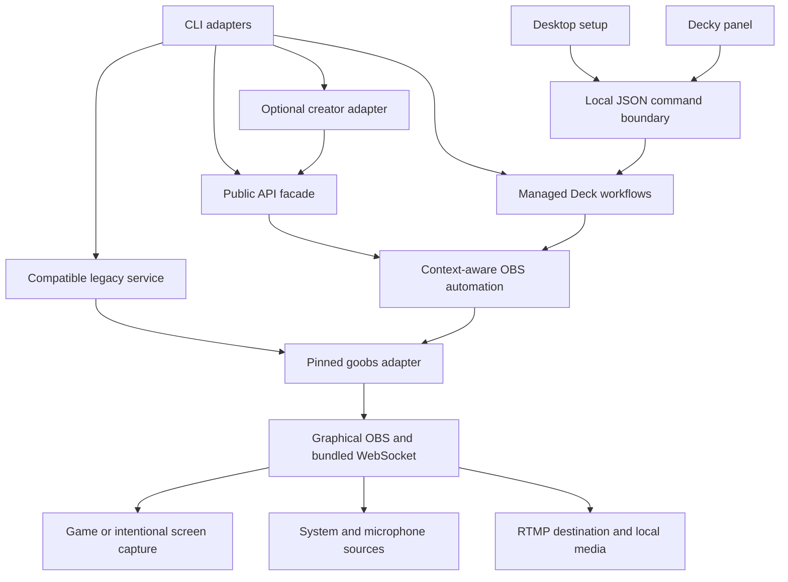

# Architecture

Decky Stream is a local OBS controller with a Steam Deck integration. The working
display name comes from `product.json`; compatible executable, Go module, plugin
identity and storage namespace remain `obsgod`/`OBSGod`. A display-name change
does not migrate an installation or establish new repository ownership.

This is the canonical component and boundary description. See
[vocabulary](ONTOLOGY.md), [decisions](DECISIONS.md), [roadmap](ROADMAP.md),
[security](SECURITY.md) and [continuity](CONTINUITY.md). Feature guides describe
individual workflows; qualification records identify the exact tested revision.

## Components and dependency direction

| Component | Responsibility and boundary |
| --- | --- |
| `main.go`, `internal/commands` | CLI composition, flags/help and command adapters |
| `internal/config` | Generic connection configuration and named connection profiles; separate from managed Deck settings and OBS's native profiles |
| `internal/obs` | Compatible legacy CLI service, lazy connection and existing command/output behavior |
| `pkg/api/v1` | Versioned facade with independent public models/errors, bounded serialized operations and explicit operation approvals; used by `obsgod api` |
| `pkg/automation` | Context-aware OBS control/observation/workflows through pinned `goobs`; no application installation, provider API or UI |
| `pkg/creator/v1` | Optional creator adapter consuming the public facade, with environment-backed RTMP providers; used by `obsgod creator` |
| `internal/deck` | Managed Linux/Flatpak OBS lifecycle, serialized controls, private settings, capture, audio and local media; owns only its managed instance/data |
| `steamdeck/bridge.py`, `steamdeck/decky/main.py` | Unprivileged JSON invocation of `obsgod deck`; no duplicate OBS WebSocket implementation |
| `steamdeck/setup.*`, `steamdeck/decky/src` | Desktop setup and controller panel; project observed state rather than infer success from a click |
| `steamdeck/install.py`, `update.py`, `uninstall.py` | Validated install/replacement/recovery/removal; preserve ordinary OBS, unrelated plugins and shared dependencies |
| `steamdeck/capture` | Narrow app-filtered Gamescope/PipeWire source; unusable game selection cannot become desktop capture |
| `scripts`, `.github/workflows`, `docs/evidence` | Builds, local/CI checks, packaging and evidence; compilation is not execution on the target |

`pkg/api/v1` provides independent types/errors and schema-versioned JSON through
`obsgod api`. Operations are serialized, bounded by context/timeouts and close
the acquired transport on cancellation before reuse. Explicit per-operation
approvals preserve output-change authorization. The facade covers snapshots,
streaming, recording/replay, scene/virtual-camera and workflow operations; it is
a candidate contract, not a published stable product release. The legacy
`internal/obs` command family remains an explicit compatibility path and is not
fully migrated to this facade; that original #9 criterion remains partial.

`pkg/creator/v1` consumes the facade without duplicating OBS protocol. Its
plan/start/status/stop/extensions CLI operates on an existing OBS connection;
it neither launches/exits OBS nor creates a companion repository. Its providers
resolve private environment references and configure RTMP(S), without platform
API contacts or provider-reception claims. The creator/StreamGod boundary in
#13 remains orchestration above OBS control; see
[the boundary decision](docs/decisions/0003-core-and-creator-boundary.md).

## Runtime and state ownership

OBS is a graphical application controlled through its bundled WebSocket, not a
headless renderer. Managed operation uses user-installed OBS 28+ and its
compatible GStreamer extension. It does not install a second WebSocket plugin
or disable SteamOS read-only protection. Generic commands connect to an existing
OBS; managed Deck commands use isolated Flatpak configuration and a separately
authenticated local listener. The [isolation repair](docs/flatpak-config-isolation.md)
explains why the environment is selected inside the sandbox.

Go owns serialization, time budgets, source selection and output transitions.
Desktop and Decky use the same control boundary; a cross-process lease prevents
competing managed lifecycle operations. Clients preserve pending/unknown state
when operations are running or observations fail. Desired settings, a successful
request and confirmed OBS output are distinct facts.

Start observes valid capture and fresh advancing output bytes before reporting
success. A socket, active flag alone or old byte counter cannot establish
readiness. Stop/Cancel use observed state; repeated actions must not manufacture
repeated success notifications. OBS-confirmed transmission still does not prove
a provider received audible video: that needs a separate viewer test.

## Output, privacy and recovery invariants

- Broadcasting requires explicit Start. Installation, recording, replay,
  configuration, reconnection and recovery cannot start a broadcast.
- Game-only selects a verified application's frames. Missing, ambiguous or
  unsupported capture shows intentional idle output; it never silently becomes
  whole-screen capture. Screen capture is a separate choice. Game-only video
  does not imply per-app audio.
- Managed operation preserves ordinary OBS profiles and unknown processes.
  Restart, connection changes, replacement and removal consult stream/recording/
  replay state; unknown state cannot authorize a destructive step.
- Failure cleanup stops only output newly started by that operation. A failed
  repeated Start must not stop a pre-existing stream.
- Audio recovery restores verified sources within bounded retries, preserves
  user mute/gain and leaves system volume alone. Hardware-specific microphone
  availability comes from observations, not just a device-model assumption.
- Recording/replay/streaming have independent lifecycles. Finalize recording and
  observe newly saved replay files before reporting success. Disk pressure
  protects local media without silently ending a stream.
- Idle media are validated local files, privately copied and hashed. Imported
  video is muted. A user rights acknowledgement does not establish ownership or
  permission to redistribute an asset.
- Retention/removal uses an explicit validated preview. Changed, unindexed,
  interrupted or symlinked files are not broad deletion targets. Media removal
  is a separate choice from application uninstall.

See [resilience](docs/runtime-resilience.md),
[recording/replay](docs/recording-replay.md) and
[device acceptance](docs/m3-device-acceptance.md) for procedures and limitations.

## Configuration, secrets and paths

Generic settings resolve flags, environment, selected JSON profile, base JSON
and defaults in that order. Ordinary OBS defaults to localhost:4455; the managed
listener uses its separate local endpoint. Generic `--password` remains a legacy
interface; prefer password-file or environment/reference support so secrets need
not enter argv/history. See [configuration](docs/configuration.md) for exact
names, profiles and paths.

Managed settings/data/state/cache/ephemeral coordination use their respective
XDG roles. Decky-provided user/path values locate the actual player and
integration directories. Loader persistent runtime-data is not interchangeable
with `XDG_RUNTIME_DIR`. Setup is loopback-only with token/origin checks. Clients
invoke a fixed executable with JSON input rather than building shell commands
containing stream keys.

Destination keys, OBS control passwords and setup authorization tokens have
different purposes and must not be reused. Diagnostics/support bundles project
allowlisted safe fields rather than unrestricted errors/configuration. Never
add arbitrary server logs or credentials to public evidence. See
[security policy](SECURITY.md).

## Product and external boundaries

The generic core owns OBS control. Provider presets validate RTMP(S) destination
configuration above it; presets do not imply OAuth, account APIs or simultaneous
multistream. Creator automation/content distribution are optional consumers.
Local recording/replay does not grant content rights or authorize publication.

The owner selected **Decky Stream** as a working name and requested a future
`decky-stream` identity. Organization, final mark/creative approval, domain,
transfer and companion-project disposition remain owner decisions. Configured
funding links do not establish verified payout ownership. Unconfigured wallets
remain hidden. #51 separately holds monetization and Store research; completing
the local plugin does not resolve that research.

## Change, release and evidence boundaries

Source preparation, local checks and reviewable draft PRs are authorized for this
completion campaign. Publication, deployment, spending, transfers and changes in
other repositories need their applicable owner authorization. This adds no gate
for routine reversible implementation. Respect protections and inspect workflow
side effects before a merge that could publish or deploy.

API/toolchain versions, package candidates, published releases and installed
runtimes are distinct identities. Record exact source/dirty state, commands,
platform/tools/dependencies, hashes and outcomes. Distinguish passed, failed,
skipped, unavailable and unrun. Old receipts become historical after source
changes. Native OBS, fixtures, browsers and cross-builds cannot establish actual
SteamOS/Flatpak/Gamescope/controller/provider/adoption or hosted CI acceptance.
Packaging a candidate does not publish it.

The owner requested consolidation after review/merges into one implementation
checklist, keeping #51 separate. A superseded issue must transfer every remaining
original criterion and dependency. Consolidation cannot mark missing device,
CI, rights, review or adoption evidence passed.
