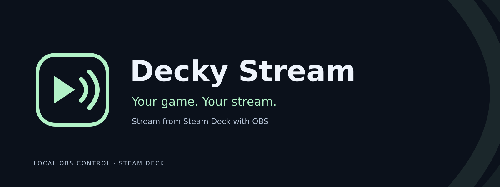

<p align="center">
  <picture>
    <source media="(prefers-color-scheme: light)" srcset="branding/repository/header-light.png">
    <source media="(prefers-color-scheme: dark)" srcset="branding/repository/header.png">
    
  </picture>
</p>

# Decky Stream

**Stream from Steam Deck with OBS.** Set up in Desktop Mode, then control your
stream, microphone and local recordings from Decky's Quick Access panel in
Gaming Mode.

[Install the review build](docs/current-review-install.md) ·
[User guide](docs/steam-deck.md) · [Get help](SUPPORT.md) ·
[Roadmap](ROADMAP.md) · [Support development](#support-development)

**Development preview.** The linked review build has passed its available local
qualification. Actual Deck/provider-viewer acceptance, required CI and applicable
reviews remain open. See the [exact-source results](audits/qualification-4699235.md)
for what passed and what remains unrun or unavailable. The executable, installed
plugin and storage compatibility names are still `obsgod` / `OBSGod`.

## What you can do

| Control | In the development candidate |
| --- | --- |
| Go live | Guided Kick, Twitch, YouTube and custom RTMP(S) setup; automatic status and observed-state Start/Stop/Cancel controls. |
| Choose the picture | Explicit entire-screen or game-only video, with intentional black/text or local image/video between-game output. Game-only capture never silently becomes desktop capture. |
| Mix your audio | Stream-only microphone selection, mute, gain and meters, plus optional focused-panel hold-to-talk. Game-only video does not isolate audio per app. |
| Keep a copy | Local recording and replay, finalized clip export, disk limits and explicit cleanup choices. Imported idle video has a muted soundtrack. |
| Tune and troubleshoot | Quality presets, advanced profiles, settings-only exports, bounded recovery, stream health and a copyable diagnostic console. |
| Stay in control | Installer/update/repair and scoped uninstall/reset/wipe paths that preserve ordinary OBS, unrelated plugins and user media unless removal is explicitly selected. |

Broadcasting requires an explicit **Start**. Installing, changing settings,
making a local clip or recovering a connection does not start a stream.

## Install and make your first stream

You need Steam Deck Desktop/Gaming Mode, Decky Loader and compatible OBS Studio
with its capture/audio dependencies. The full installer checks dependencies and
installs the paired Decky plugin; follow the guide for prerequisites and any
action it requests.

1. In **Desktop Mode**, stop streaming, recording and replay. Keep Steam and
   Decky running, then use the [checksum-verifying review installer](docs/current-review-install.md).
2. Open **Decky Stream Setup** from Applications and configure the destination
   and stream key locally. Preserve your existing settings and recordings.
3. Return to **Gaming Mode** and open the plugin through Decky's Quick Access
   panel. Make a local test clip and verify both its picture and sound.
4. Select the intended picture/audio, explicitly **Start streaming**, and check
   the result from a separate viewer. OBS reporting transmission does not prove
   the destination received audible video.

The [Steam Deck guide](docs/steam-deck.md) covers setup and recovery. OBS 28+
includes its WebSocket server, so a second WebSocket plugin is unnecessary.
OBS remains a graphical application managed in the background; a graphical
session is required.

The linked manual review checkpoint is exact source `4699235e9e925b76ca492d5a00a375ed37fb338e`,
not a newly published release or an update offered by **Check for updates**.
The older [1a/d0a candidate](docs/candidate-9-install.md) remains unchanged, and
[published previews](https://github.com/szmyty/obsgod/releases) do not contain all
current work. Use the source revision and checksums supplied with your candidate.

## Documentation

- **Set up:** [Steam Deck guide](docs/steam-deck.md),
  [destinations and password recovery](docs/stream-destinations.md),
  [configuration, environment and completions](docs/configuration.md).
- **Create:** [microphone and headsets](docs/microphone.md),
  [quality profiles](docs/advanced-profiles.md), [between-game media](docs/idle-media.md),
  [recording/replay](docs/recording-replay.md).
- **Recover:** [runtime recovery](docs/runtime-resilience.md),
  [stream health](docs/stream-health.md), [support and diagnostics](SUPPORT.md).
- **Understand:** [architecture](ARCHITECTURE.md), [vocabulary](ONTOLOGY.md),
  [decisions](DECISIONS.md), [qualification](docs/steam-deck-qualification.md),
  [release engineering](docs/release-engineering.md).
- **Follow the project:** [roadmap](ROADMAP.md),
  [M2 implementation ledger](docs/milestone-2.md), [OBSGod memorial](MEMORIAL.md),
  [identity/migration decisions](docs/identity-migration.md),
  [draft brand review](docs/branding-review.md) and [site preview](docs/branding-site-preview.md).

Repository artwork is a proposed Decky Stream identity for review. Its creative
and rights status is recorded in the brand review; it does not establish final
brand approval or change the installed plugin's native theme.

## CLI and automation

The reusable CLI also controls an existing OBS instance:

```sh
obsgod --help
obsgod version --json
obsgod config show --json
obsgod stream status --json
obsgod deck support-bundle > decky-stream-support.json
```

Help, version and completions work offline. OBS operations require the intended
instance; inspection and profile selection do not implicitly broadcast. See
[CLI usage](docs/cli-usage.md) for the remote command family.

The generic CLI is installable with
`go install github.com/szmyty/obsgod@latest`. A Go install alone does not install
the complete managed Steam Deck application.

## Development and validation

Use pinned Go **1.27.4**, Node **24.19.0**, npm **11.9.0** and Python **3.12+**.
See [building and qualification](docs/steam-deck-building.md) for the full
toolchain, Docker/browser/native dependencies and exact available matrix.

```sh
go mod download
npm --prefix steamdeck/decky ci --ignore-scripts
go test -race ./...
go vet ./...
python3 -m unittest discover -s steamdeck/tests -p 'test_*.py' -v
npm --prefix steamdeck/decky run typecheck
npm --prefix steamdeck/decky test
npm --prefix steamdeck/decky run build
```

These are starting checks, not the full release gate. [Local CI](docs/local-ci.md)
runs the existing workflows with pinned `act` tooling and explicit platform/API
limitations. Hosted Actions are currently unavailable because of the account
billing lock; local results do not become hosted passes. Cross-builds do not
establish native platform or Steam Deck support.

Generate display metadata with `python3 scripts/generate-product.py` and support
metadata with `node scripts/generate-support.mjs`. Package only a clean, exact
source revision. New contributors should read [CONTRIBUTING.md](CONTRIBUTING.md)
and [AGENTS.md](AGENTS.md); [CONTINUITY.md](CONTINUITY.md) identifies current work.

## Support development

The local core is free to use without payment or a service account. Optional
support helps its development:

[GitHub Sponsors](https://github.com/sponsors/szmyty) ·
[Buy Me a Coffee](https://www.buymeacoffee.com/szmyty) ·
[Ko-fi](https://ko-fi.com/szmyty) ·
[Open Collective](https://opencollective.com/szmyty) ·
[thanks.dev](https://thanks.dev/u/gh/szmyty)

These links use the same handles as [.github/FUNDING.yml](.github/FUNDING.yml)
and the packaged support buttons. Cryptocurrency options remain hidden while
receiving addresses are unconfigured. See [support configuration](docs/support.md)
for the provider and wallet boundaries. Funding does not purchase a support
agreement or change access to streaming, Stop or recovery.

## Help, security and license

Use [SUPPORT.md](SUPPORT.md) for reproducible problems and filtered diagnostics.
The preview has no promised response time. Never post stream keys, OBS passwords,
private setup links or raw OBS configuration/logs. For suspected vulnerabilities,
follow [SECURITY.md](SECURITY.md), including its private-reporting fallback.

The original CLI [MIT license and attribution](LICENSE) are retained from
[`muesli/obs-cli`](https://github.com/muesli/obs-cli). OBS/GStreamer are separate
dependencies; review packages retain bundled dependency notices and native
preferred source. This is an independent community project and is not endorsed
by Decky, Valve or OBS.
